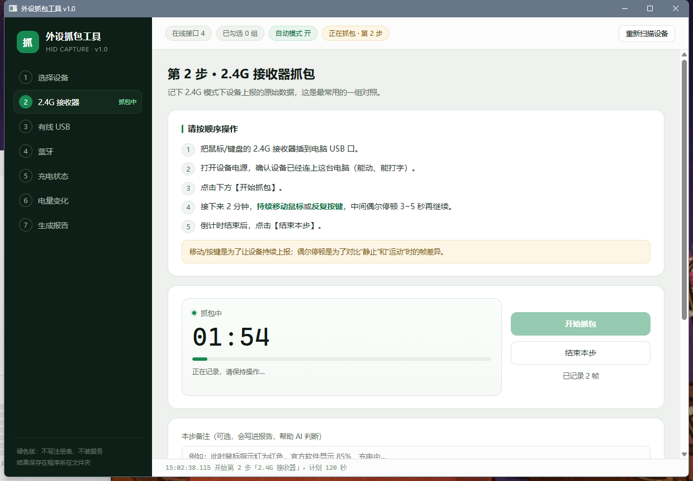

# 外设抓包工具 · Peripheral Capture Tool

一个面向**键鼠外设**的 HID 抓包向导：跟着界面一步步操作，就能把 2.4G、有线、蓝牙、充电状态、电量变化等场景下的原始上报数据完整录下来，自动整理成报告，直接交给 AI 分析电量字段和充电状态字段。

不需要抓包经验，也不需要懂代码。



## 为什么做这个

很多键鼠厂商的电量协议没有公开文档。想给自己的软件适配一款新设备，最费时间的不是写代码，而是搞清楚：

- 电量字段在第几个字节？是百分比还是分级？
- 充电状态是哪个字节？0/1/2/3 分别代表什么？
- 2.4G、有线、蓝牙三种模式的上报格式一样吗？

这个工具把"插拔设备、点几下、等两分钟"变成了一套有倒计时和提示的固定流程，输出原始帧 + 自动分析，交给 AI 就能得到结论和解析代码。

## 功能

- **按 VID/PID 自动发现设备**：列出所有 HID 接口、名称、类型（鼠标/键盘/厂商自定义），支持多选
- **自动模式**：默认抓取所有键鼠类接口，切换连接方式后新出现的接口会自动纳入，不用重新选择
- **分阶段抓包**：2.4G 接收器 / 有线 USB / 蓝牙 / 充电状态 / 电量变化，每步有操作说明、开始/结束按钮、倒计时
- **实时帧流**：十六进制显示最近上报，自动标出落在 1~100 的候选字节
- **去重限流**：相同帧按心跳记录，每接口每步上限 500 帧，1000Hz 鼠标也不会撑爆
- **自动报告**：帧数、间隔、逐字节分布、电量候选、跨步骤差异、关键帧样例
- **绿色单文件**：Rust + WebView2，不写注册表、不装服务、不联网

## 下载使用

前往 [Releases](https://github.com/Alioneo/Peripheral-Capture-Tool/releases/latest) 下载 `外设抓包工具_v1.0.0_绿色版.zip`，解压后双击 `外设抓包工具.exe`。

系统要求：Windows 10 / 11 64 位，带 WebView2 运行时（Win11 自带；Win10 缺失时安装 Microsoft Edge WebView2 Runtime）。

### 抓包流程

| 步骤 | 做什么 |
| --- | --- |
| 1 | 勾选你的键鼠设备（不确定就保持自动模式） |
| 2 | 插 2.4G 接收器，开始抓包，持续移动/按键 2 分钟 |
| 3 | 插 USB 线，抓 2 分钟，**倒计时结束后先拔线再结束本步** |
| 4 | 蓝牙配对连接，抓 2 分钟 |
| 5 | 充电 60 秒 → 拔充电线等 30 秒，备注指示灯/软件显示 |
| 6 | 不充电正常使用 5 分钟 |
| 7 | 生成报告，把结果文件夹发给 AI |

### 输出文件

| 文件 | 内容 |
| --- | --- |
| `frames.jsonl` | 逐帧原始数据，每行一个 JSON（含 Report ID） |
| `设备与字段分析.md` | 字节分布、电量/状态位候选、跨步骤差异、关键帧 |
| `给AI的说明.md` | 文件说明 + 建议提问模板 |
| `设备列表.txt` | 本次涉及的 HID 接口清单 |

结果保存在 exe 同目录；目录不可写时自动写到 `%LOCALAPPDATA%\HIDCapture`。

## 从源码构建

```bash
cargo build --release --offline   # 或去掉 --offline 让 cargo 联网拉依赖
```

产物：`target/release/hid-capture.exe`。

依赖只有 [`wry`](https://crates.io/crates/wry)（WebView2 封装），HID 枚举与读取全部是手写 Win32 FFI（setupapi / hid / kernel32）。

命令行排障：

```bash
hid-capture.exe --list        # 列出所有 HID 接口
hid-capture.exe --probe 15    # 后台抓 15 秒并打印汇总
```

## 隐私与安全

- 只以 `GENERIC_READ` 打开 HID 设备，不写设备、不模拟输入
- 不联网、不写注册表、不装服务
- 所有数据仅保存在本地

## 相关项目

- [Peripheral-Power-Monitoring](https://github.com/Alioneo/Peripheral-Power-Monitoring)：键鼠电量监测小组件。本工具产出的抓包结果可用于为它适配新设备。

## 许可证

[MIT](LICENSE)
